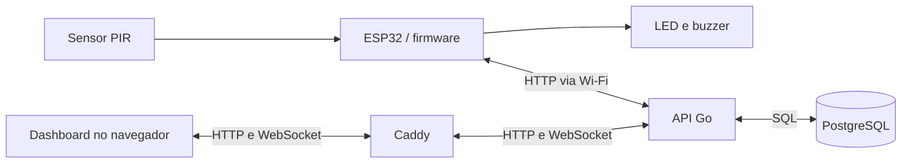

# WallAce

### Produto: Sistema de Alarmes Remotamente Configurável

### Integrantes: Caio Hygino Perlin, Caio Ricarte Loyer e Murilo Toledo

## Objetivo do Projeto

Criar um sistema IoT de detecção e monitoramento de movimento utilizando um ESP32 e um sensor PIR, permitindo o acompanhamento das detecções em tempo real por meio de um dashboard web e o controle remoto dos feedbacks físicos do dispositivo.

## A Necessidade (Por que construir?)

Ambientes residenciais, comerciais ou institucionais podem necessitar de uma forma simples de identificar movimentações e acompanhar esses eventos remotamente. Soluções tradicionais de monitoramento podem ser mais complexas, caras ou pouco flexíveis para projetos de pequeno porte. O WallAce busca oferecer uma alternativa simples e conectada, capaz de registrar detecções de movimento, disponibilizar essas informações em tempo real e permitir que o usuário controle e configure remotamente os alertas físicos do dispositivo.

## Descrição do Produto (Como vai funcionar)

O WallAce utilizará um dev kit ESP32 conectado à rede Wi-Fi. Na camada de percepção, será utilizado um sensor PIR, responsável por detectar movimentações no ambiente. O dispositivo também contará com um LED e um buzzer como atuadores para fornecer feedback visual e sonoro sempre que uma movimentação for identificada.

- Edge/Borda: O ESP32 realizará continuamente a leitura do sensor PIR. Ao detectar movimento, o dispositivo registrará o evento, poderá acionar localmente o LED e o buzzer e enviará a detecção ao servidor através da rede Wi-Fi. O funcionamento dos atuadores poderá ser habilitado ou desabilitado remotamente pelo usuário, sem necessidade de reprogramar o ESP32.
- Nuvem/Aplicação: O backend será desenvolvido em Go e ficará responsável por receber os eventos enviados pelo ESP32 e distribuí-los em tempo real para o dashboard. A comunicação entre o servidor e a interface web será realizada por WebSocket. O frontend, desenvolvido em TypeScript, exibirá as detecções recentes e manterá um histórico dos eventos registrados. Pelo dashboard, o usuário também poderá habilitar ou desabilitar remotamente o buzzer e o LED, e o servidor enviará essas configurações de volta ao ESP32.


## Componentes Necessários e Como Conectar

### Componentes

- Dev kit ESP32 e cabo USB
- Sensor de movimento PIR HC-SR501
- LED e resistor de 220–330 Ω
- Buzzer ativo (mais simples para ligar/desligar) ou passivo (requer sinal PWM/tom)
- Protoboard e jumpers
- Para um buzzer sem módulo driver: transistor NPN e resistor de base; use também um diodo de flyback se o buzzer for indutivo

### Ligações sugeridas

O mapa abaixo é uma sugestão para um ESP32 DevKit clássico com módulo ESP32-WROOM. Confira a identificação dos pinos no modelo exato da placa e registre as ligações finais em [`firmware/README.md`](firmware/README.md).

| Pino do componente          | Conectar a                                  |
| --------------------------- | ------------------------------------------- |
| `VCC` do HC-SR501           | `5V` da placa ESP32                         |
| `GND` do HC-SR501           | `GND` da placa ESP32                        |
| `OUT` do HC-SR501           | `GPIO27` do ESP32                           |
| Ânodo do LED (perna longa)  | `GPIO18` em série com resistor de 220–330 Ω |
| Cátodo do LED (perna curta) | `GND` do ESP32                              |

Para um buzzer sem módulo driver, use `GPIO19` para controlar um transistor NPN através de um resistor de base (1 kΩ é um ponto de partida para um buzzer pequeno). Conecte o emissor do transistor ao `GND`, o coletor ao polo negativo do buzzer e o polo positivo à tensão indicada no componente. Una os terras do ESP32, do sensor e da fonte do buzzer. Confira o pinout do transistor antes de montar. Se o buzzer for indutivo, coloque um diodo de flyback em paralelo, com o catodo voltado para a alimentação positiva. Em um módulo driver, conecte os pinos `SIG`/`IN`, alimentação e `GND` conforme as marcações do módulo.

A especificação comum do HC-SR501 indica alimentação de 4,8–20 V e saída de 3,3 V. Há variações entre módulos; confira a tensão do pino `OUT` antes de ligá-lo. Nunca aplique 5 V diretamente a um GPIO do ESP32. Consulte a [especificação do HC-SR501](https://www.datocms-assets.com/28969/1662716328-hc-sr501.pdf), o [pinout do ESP32-DevKitC da Espressif](https://docs.espressif.com/projects/esp-dev-kits/en/latest/esp32/esp32-devkitc/user_guide.html) e a [orientação da Espressif sobre tensão nos GPIOs](https://docs.espressif.com/projects/esp-faq/en/latest/esp-faq-en-master.pdf).

## Integração do Firmware

A implementação do firmware e a montagem física ficam com **Caio Ricarte Loyer e Murilo Toledo**. O sketch e o processo de gravação são mantidos separadamente; este repositório contém o contrato de integração e a stack local.

1. Na raiz do repositório, suba a API, o dashboard e o banco com `docker compose up --build`.
2. Conecte o ESP32 à mesma rede Wi-Fi e configure a URL da API como `http://<IP-do-computador-na-rede>:8080`. Não use `localhost` no ESP32: nesse caso, ele apontaria para a própria placa.
3. Configure Wi-Fi e o mesmo `API_TOKEN` usado pela stack em um arquivo local não versionado. O `.env.example` usa `dev-token` para desenvolvimento; não versione credenciais reais.
4. Use o endereço MAC de fábrica do ESP32 como `device_id`. Implemente o envio de detecções, a consulta periódica da configuração e o heartbeat conforme o [contrato OpenAPI](docs/api.yaml).
5. Consulte o [guia de integração do firmware](firmware/README.md) para intervalos, comportamento dos atuadores e montagem. Use as ligações acima como ponto de partida, confirme os GPIOs durante a montagem e registre os valores finais no guia.
6. Faça um teste de ponta a ponta pelo dashboard: as detecções devem aparecer, e as mudanças de LED ou buzzer devem chegar ao ESP32 na próxima consulta de configuração.

O OpenAPI é a fonte de verdade para rotas, autenticação, payloads e mensagens do dashboard. O [guia de integração da API](docs/api.md) explica o roteamento local.

## Como as Partes se Conectam

| Parte                               | Responsabilidade                                                               | Comunicação                                                     |
| ----------------------------------- | ------------------------------------------------------------------------------ | --------------------------------------------------------------- |
| ESP32 e firmware                    | Ler o PIR e acionar LED/buzzer conforme a configuração                         | Requisições HTTP para a API pela rede Wi-Fi                     |
| API Go (`api/`)                     | Validar o token, registrar dados e distribuir novas detecções                  | HTTP, SQL e WebSocket                                           |
| PostgreSQL                          | Guardar dispositivos, configurações, último heartbeat e histórico de detecções | Acessado pela API dentro da rede do Compose                     |
| Dashboard React/TypeScript (`web/`) | Exibir dispositivos e histórico e permitir ajustes dos atuadores               | HTTP para consultas/alterações e WebSocket para novas detecções |
| Caddy                               | Servir o dashboard e encaminhar `/api/*`, `/ws/*` e `/docs` para a API         | Entrada do navegador na porta `5173`                            |



O Compose executa API, dashboard/Caddy e banco. O firmware é desenvolvido e gravado separadamente no ESP32.

### Fluxo de uma detecção

1. O PIR detecta movimento; o firmware decide se aciona LED e buzzer usando a última configuração recebida.
2. O ESP32 envia `POST /api/devices/{device_id}/detections` com o instante da detecção em segundos Unix.
3. A API grava a detecção no PostgreSQL e publica uma mensagem WebSocket para os dashboards conectados.
4. O dashboard usa o `device_id` da mensagem para atualizar o feed do dispositivo. O histórico persistido é consultado por HTTP em `GET /api/devices/{device_id}/detections`.

### Configuração e presença do dispositivo

Ao mudar um toggle, o dashboard envia `PUT /api/devices/{device_id}/config`. A API salva os valores, e o ESP32 os busca com `GET` na mesma rota a cada **3–5 segundos**. Por isso, a mudança pode levar alguns segundos para chegar ao hardware.

O ESP32 deve enviar `POST /api/devices/{device_id}/heartbeat` a cada **15–30 segundos**. A API considera o dispositivo online quando o último heartbeat tem até **60 segundos**. O dashboard consulta a lista de dispositivos a cada **5 segundos**, atualizando presença e configurações. Atualmente, o WebSocket transmite apenas detecções.

## Subindo e Acessando a Stack

Se precisar personalizar a configuração local, crie um `.env` a partir de `.env.example`. Na raiz do repositório, execute:

```sh
docker compose up --build
```

| Acesso                            | Endereço                                  |
| --------------------------------- | ----------------------------------------- |
| Dashboard                         | <http://localhost:5173>                   |
| Swagger pelo Caddy                | <http://localhost:5173/docs>              |
| Swagger diretamente na API        | <http://localhost:8080/docs>              |
| Contrato OpenAPI servido pela API | <http://localhost:8080/docs/openapi.yaml> |
| API para o ESP32                  | `http://<IP-do-computador-na-rede>:8080`  |

No navegador do computador que executa a stack, `localhost` aponta para esse computador. No ESP32 ou em outro computador, use o IP da máquina que executa o Compose. Os nomes `api` e `db` são endereços internos da rede Docker.

Para encerrar, use `docker compose down`. O volume do PostgreSQL preserva os dados entre reinicializações da stack.

### Acesso e autenticação

Não há cadastro de usuário nem login com senha. As rotas `/api/devices` usam um token compartilhado: `Authorization: Bearer <API_TOKEN>`.

No Swagger, clique em **Authorize**, informe somente o token, confirme **Authorize** no diálogo e feche-o. O padrão local é `dev-token`, salvo alteração de `API_TOKEN` no `.env`. O Swagger adiciona `Bearer` ao cabeçalho; um `401` indica token ausente ou incorreto.

O dashboard recebe o mesmo token como `VITE_API_TOKEN` durante o build feito pelo Compose. Depois de alterar `API_TOKEN`, execute novamente `docker compose up --build` para reconstruir o dashboard e atualizar a API; ajuste também o token no firmware. Os endpoints de health e o WebSocket estão abertos na implementação atual.

## WebSocket: Detecções em Tempo Real

O navegador abre uma conexão em `/ws/dashboard`. Ela permanece aberta para a API enviar detecções, sem precisar consultar repetidamente se há novos eventos. Todos os dashboards conectados recebem eventos de todos os dispositivos; cada mensagem contém o `device_id` para identificar o sensor.

- Pelo Caddy: `ws://localhost:5173/ws/dashboard`.
- Diretamente na API: `ws://localhost:8080/ws/dashboard`.
- Quando a aplicação estiver atrás de HTTPS, use `wss://` no mesmo host.
- O ESP32 usa HTTP; não precisa abrir WebSocket.
- A conexão atual não exige token e as mensagens enviadas pelo cliente não executam comandos na API.

Exemplo de mensagem enviada pela API:

```json
{
  "type": "detection",
  "device_id": "A4:CF:12:34:56:78",
  "ts": 1732300000
}
```

Para observar o fluxo, abra o console do navegador no dashboard ou no Swagger local e execute:

```js
const protocol = window.location.protocol === "https:" ? "wss:" : "ws:";
const socket = new WebSocket(
  `${protocol}//${window.location.host}/ws/dashboard`,
);
socket.addEventListener("message", (event) =>
  console.log(JSON.parse(event.data)),
);
socket.addEventListener("close", () => console.log("WebSocket desconectado"));
```

Com a conexão aberta, envie uma detecção pela operação `POST /api/devices/{device_id}/detections` no Swagger, após autorizar o token. A mensagem aparecerá no console e o evento ficará no histórico. Ao terminar a observação, execute `socket.close()`.

O WebSocket não oferece confirmação nem replay de eventos: mensagens podem ser perdidas durante uma desconexão ou quando o cliente não acompanha o envio. Para recuperar o histórico, consulte `GET /api/devices/{device_id}/detections`, usando `limit` e `offset`. O dashboard atual abre a conexão ao carregar a página e ainda não reconecta automaticamente; se ela cair, recarregue a página e abra o histórico do dispositivo.

O contrato das mensagens está na extensão `x-websockets` do [OpenAPI](docs/api.yaml). O Swagger tem uma seção explicativa para o WebSocket; os botões **Execute** das operações HTTP não abrem essa conexão.
